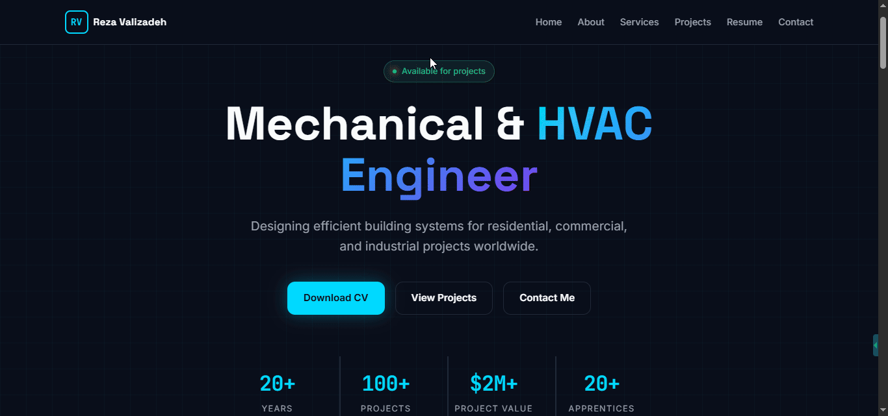
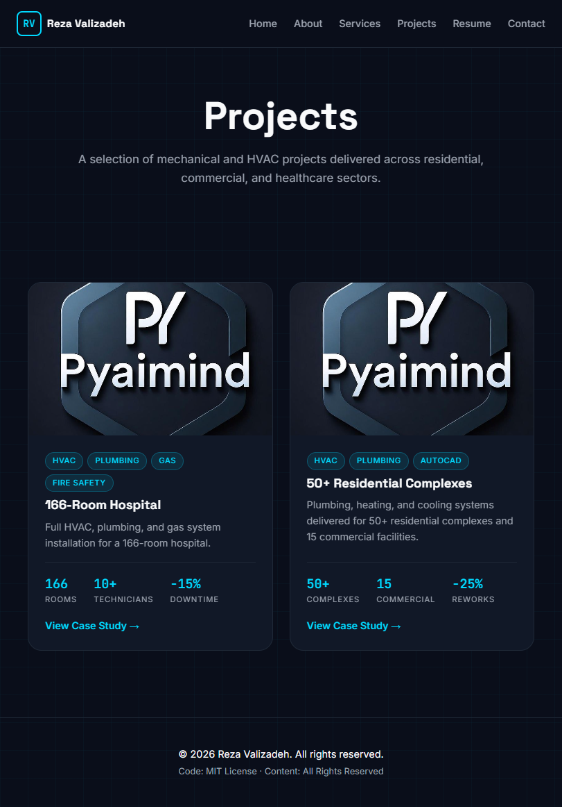
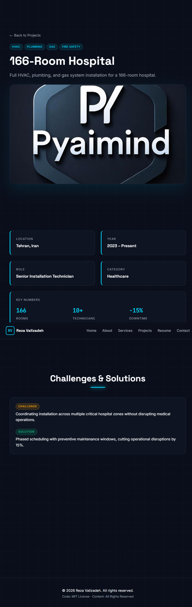
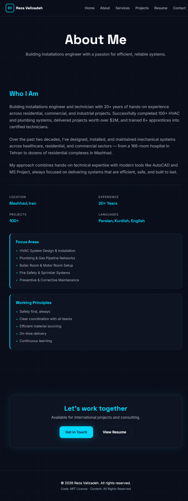
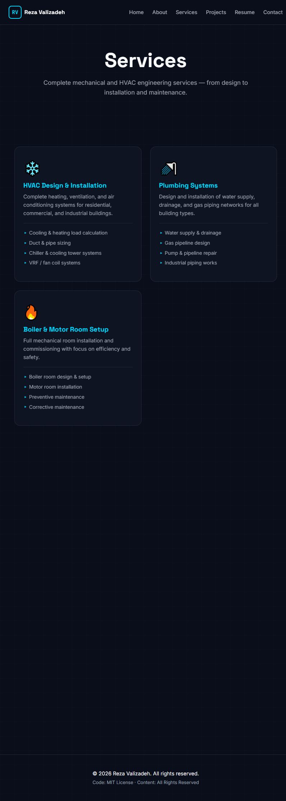
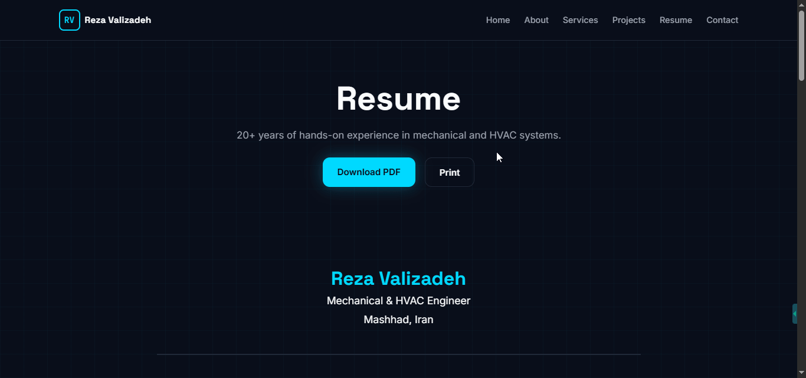
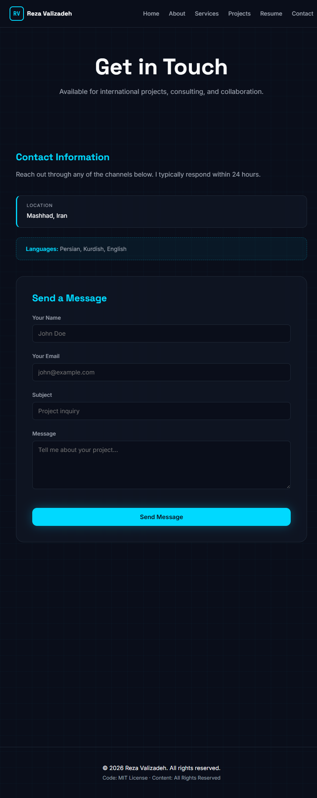

# 🏗️ HVAC Engineer Portfolio


A modern, responsive portfolio website for a **Mechanical & HVAC Engineer** targeting international clients, employers, and academic opportunities.

🌐 **Live Demo:** [https://pyaimind.github.io/hvac-portfolio/](https://pyaimind.github.io/hvac-portfolio/)

---
## 🎬 Preview



### 📸 Screenshots

| Projects Gallery | Project Detail |
|:---:|:---:|
|  |  |

| About | Services |
|:---:|:---:|
|  |  |

| Resume | Contact |
|:---:|:---:|
|  |  |

---

## ✨ Features

- 📱 **Fully Responsive** — Mobile-first design, tested on all screen sizes
- 🎨 **Dark Industrial Theme** — Modern cyan accent with glassmorphism
- ⚡ **Zero Build Tools** — Pure HTML, CSS, and JavaScript
- 📊 **JSON-Driven Content** — Update data without touching code
- 🎬 **Smooth Animations** — Scroll-triggered fade-ins with AOS.js
- 📄 **Print-Ready Resume** — Clean print stylesheet for PDF export
- 📬 **Working Contact Form** — Powered by Web3Forms (no backend)
- 🔍 **SEO Optimized** — Sitemap, robots.txt, and meta tags
- ♿ **Semantic HTML** — Accessible and clean markup

---

## 🛠️ Tech Stack

| Layer | Technology |
|-------|-----------|
| Markup | HTML5 (semantic) |
| Styling | CSS3 (Custom Properties, Flexbox, Grid) |
| Logic | Vanilla JavaScript (ES6+) |
| Data | JSON files |
| Fonts | Space Grotesk, Inter, JetBrains Mono |
| Animations | AOS.js |
| Forms | Web3Forms |
| Hosting | GitHub Pages |

---

## 📁 Project Structure

```
HVAC_Portfolio/
├── index.html              # Home page
├── about.html              # About the engineer
├── services.html           # Service offerings
├── projects.html           # Projects gallery
├── project.html            # Project detail (case study)
├── resume.html             # Full resume with print support
├── contact.html            # Contact form
├── 404.html                # Custom error page
│
├── css/
│   ├── base.css            # Reset, variables, typography
│   ├── layout.css          # Containers, grid, sections
│   ├── components.css      # Buttons, cards, navbar, footer
│   ├── pages.css           # Page-specific styles
│   └── vendor/
│       └── aos.css         # AOS animations
│
├── js/
│   ├── main.js             # Global logic (navbar, AOS init)
│   ├── projects.js         # Projects grid rendering
│   ├── project.js          # Project detail rendering
│   ├── about.js            # About page data
│   ├── resume.js           # Resume page rendering
│   ├── contact.js          # Contact form + info
│   ├── utils.js            # Fetch, escape, helpers
│   └── vendor/
│       └── aos.js          # AOS library
│
├── data/
│   ├── profile.json        # Personal info, stats, languages
│   ├── skills.json         # Technical skills by category
│   ├── experience.json     # Work history
│   ├── certifications.json # Education & certificates
│   └── projects.json       # Project portfolio
│
├── assets/
│   ├── img/
│   │   ├── favicon.png
│   │   ├── screenshots/    # README preview images
│   │   └── projects/       # Project cover images
│   └── cv/
│       └── resume.pdf
│
├── docs/
│   ├── CONTRIBUTING.md
│   └── CHANGELOG.md
│
├── README.md
├── LICENSE
├── .gitignore
├── .nojekyll
├── robots.txt
└── sitemap.xml
```

---

## 🚀 Running Locally

Clone the repository and start a local server:

```bash
git clone https://github.com/PyAimind/hvac-portfolio.git
cd hvac-portfolio
python run.py
```

Then open [http://localhost:8080](http://localhost:8080) in your browser.

> **Note:** A local server is required because the site fetches JSON files via `fetch()` API, which requires HTTP (not `file://`).

---

## 📝 Updating Content

All content lives in the `data/` folder as JSON files. No code changes required.

### Example — Add a New Project

Edit `data/projects.json`:

```json
{
  "id": "new-project",
  "name": "Project Name",
  "location": "City, Country",
  "year": "2025",
  "category": "Commercial",
  "role": "Designer",
  "cover": "assets/img/projects/new-project.jpg",
  "summary": "Short description for the card.",
  "tags": ["HVAC", "AutoCAD"],
  "featured": true,
  "stats": [
    { "value": "10,000", "label": "m²" },
    { "value": "-20%", "label": "Energy" }
  ],
  "challenges": [
    {
      "problem": "Brief description of the challenge.",
      "solution": "How it was solved."
    }
  ],
  "gallery": []
}
```

### Files You Can Edit

| File | Purpose |
|------|---------|
| `data/profile.json` | Name, title, summary, stats, languages |
| `data/skills.json` | Skill groups (HVAC, Plumbing, Software, etc.) |
| `data/experience.json` | Work history with highlights |
| `data/certifications.json` | Education and certificates |
| `data/projects.json` | Project portfolio |

---

## 📄 License

- **Code:** MIT License — free to use, modify, and distribute
- **Content:** All Rights Reserved — resume, images, and personal data may not be reused without permission

See [LICENSE](LICENSE) for details.
```

---
